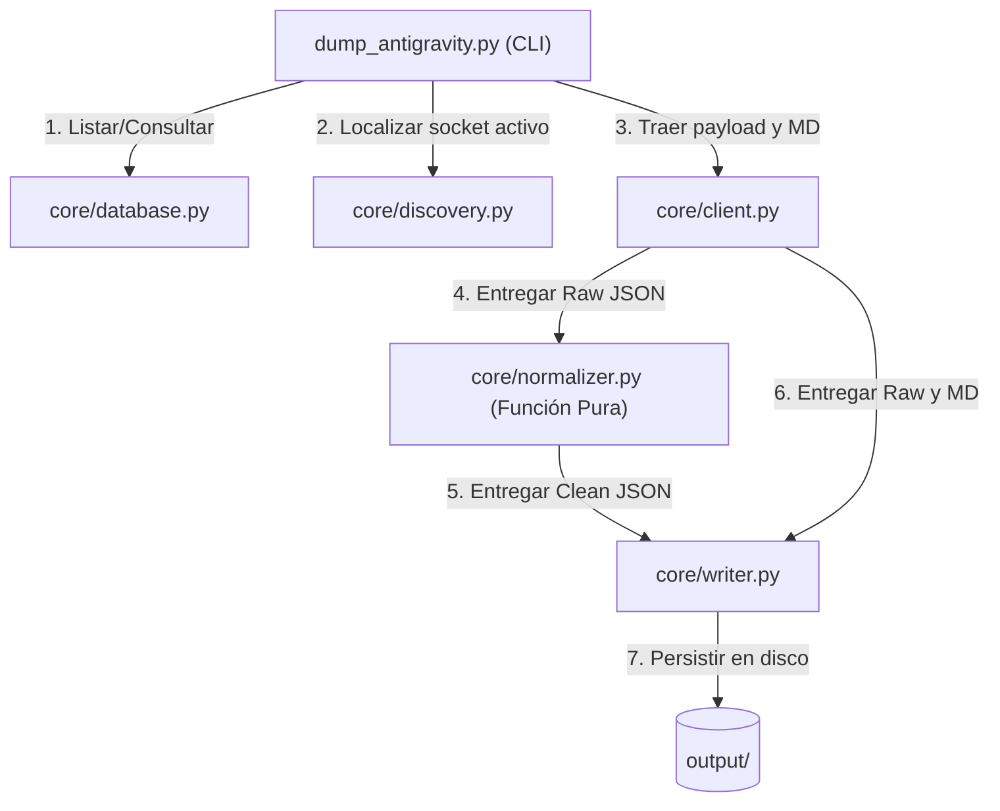

# Walkthrough: Sprint 01 — Modularización y Desacoplamiento (v1.1.0)

## 1. Contexto y Objetivo

En la versión fundacional (`v1.0.0`), se implementó un motor funcional completo dentro del script monolítico `dump_antigravity.py` (239 líneas). Aunque la herramienta demostró un 100% de efectividad al rescatar 30 conversaciones históricas, su estructura monolítica acopla en un solo archivo:
- Inspección de sockets y tokens de red.
- Consultas directas a la base de datos SQLite.
- Transporte HTTP ConnectRPC.
- Normalización del JSON.
- Persistencia en el sistema de archivos.
- Interfaz de línea de comandos (CLI).

Este acoplamiento impide la creación de pruebas unitarias limpias sin depender de sockets vivos de red o bases de datos activas en disco.

**El objetivo de este sprint es:**
1. Desacoplar `dump_antigravity.py` en módulos de responsabilidad única dentro del paquete `core/`.
2. Aislar funciones puras (especialmente en la capa de normalización) para habilitar el Testing Automatizado con fixtures en la Fase 3 (`v1.2.0`).
3. Ejecutar el refactor de forma incremental, módulo por módulo, validando que el CLI mantenga retrocompatibilidad total tras cada extracción.
4. Versionar incrementalmente mediante parches internos (`1.0.1` ➡️ `1.0.5`) hasta consolidar la release menor `v1.1.0`.

---

## 2. Arquitectura Destino (`core/`)

```text
antigravity-exporter/
├── dump_antigravity.py          # Entrypoint CLI ultra-liviano (~40 líneas, orquestador argparse)
├── core/
│   ├── __init__.py              # Declara el paquete core y exporta metadatos/versión
│   ├── discovery.py             # Detección dinámica de socket, puerto y token CSRF
│   ├── database.py              # Consultas SQLite sobre conversation_summaries.db
│   ├── client.py                # Cliente HTTP ConnectRPC (GetCascadeTrajectory, ConvertTrajectoryToMarkdown)
│   ├── normalizer.py            # Función PURA de transformación (Raw JSON -> Clean JSON)
│   └── writer.py                # Persistencia atómica de las 3 salidas en disco (raw, clean, md)
└── planification/
    └── 01-modularizacion/       # Planes de implementación específicos por módulo
```

---

## 3. Pipeline de Datos y Dependencias



---

## 4. Fases del Sprint y Tracker de Progreso

| Estado | Paso | Versión | Módulo a Extraer | Plan de Implementación | Responsabilidad |
|:---:|:---:|:---:|---|---|---|
| [x] | **1** | `1.0.1` | `core/discovery.py` | [`implementation_plan_discovery.md`](implementation_plan_discovery.md) | Detección de `hub_*.json` y chequeo de socket vivo |
| [x] | **2** | `1.0.2` | `core/database.py` | [`implementation_plan_database.md`](implementation_plan_database.md) | Consultas a SQLite `conversation_summaries.db` |
| [x] | **3** | `1.0.3` | `core/normalizer.py` | [`implementation_plan_normalizer.md`](implementation_plan_normalizer.md) | Transformación pura de payload RPC a esquema limpio |
| [x] | **4** | `1.0.4` | `core/client.py` | [`implementation_plan_client.md`](implementation_plan_client.md) | Llamadas ConnectRPC (`GetCascadeTrajectory`, etc.) |
| [ ] | **5** | `1.0.5` | `core/writer.py` | `implementation_plan_writer.md` | Creación de directorios y escritura segura en disco |
| [ ] | **6** | `v1.1.0` | `dump_antigravity.py` | `implementation_plan_cli.md` | Adelgazamiento del CLI, tests integrales y release |

---

## 5. Criterios de Aceptación del Sprint

- [ ] Cada extracción preserva la retrocompatibilidad: `dump_antigravity.py --version`, `--list`, `--id`, `--all` funcionan sin cambios para el usuario.
- [ ] La biblioteca estándar de Python sigue siendo la única dependencia (cero `pip install`).
- [ ] `core/normalizer.py` queda completamente desacoplado de I/O y de llamadas de red.
- [ ] Al finalizar el paso 6, se actualizan `docs/CHANGELOG.md`, `docs/ROADMAP.md` y `README.md` formalizando la entrega de `v1.1.0`.

